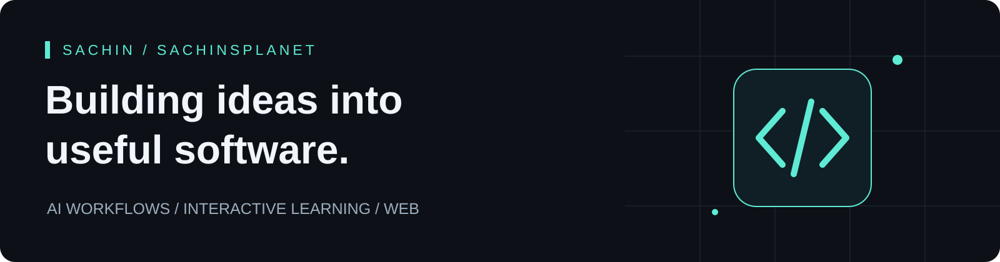

  

# Hi, I'm Sachin.

I'm a student who learns by building. I make tools that take repetitive work off your hands and help complex topics become easier to explore.

My projects span AI workflow automation, developer tooling, and interactive learning. I use AI coding tools as part of my process, with an increasing focus on clear specifications, testing, and reliable behavior.

## Start here

| Project | What it's for |
| --- | --- |
| **[Jarvistark](https://github.com/sachinsplanet/Jarvistark)** | A Codex plugin that turns a rough app idea into reviewed requirements, implementation tasks, and coding-agent context, with recorded check evidence. |
| **[QPrompter](https://github.com/sachinsplanet/qprompter)** | A browser extension for queuing prompts and running them sequentially in AI chat interfaces, with response monitoring and configurable delays. |
| **[DSPro](https://github.com/sachinsplanet/DSpro)** | An interactive introduction to data science and its career paths, built to help students find a starting point. |
| **[SparrowSQL](https://github.com/sachinsplanet/sparrowSQL)** | Hands-on SQL practice with guided exercises, a query playground, and database schema exploration. |
| **[3D Book](https://github.com/sachinsplanet/3dbook)** | A digital reading experiment exploring PDF books through a tactile, 3D page-turning experience. |

## What I'm working toward

- **Useful automation:** reduce the repeated steps between an idea and a finished task.
- **Learning through interaction:** let people try, inspect, and understand.
- **Better foundations:** improve documentation, accessibility, tests, and recovery when things fail.

## Tools in my projects

**TypeScript · JavaScript · React · Next.js · Vite · Tailwind CSS · Chrome Extensions (Manifest V3)**

I'm developing these skills through projects and sharing the work as it evolves.

## Get involved

Found a bug or have a concrete improvement? Open an issue in the relevant repository with what you tried and what you expected. Feedback from people actually using the projects is especially helpful.

[Explore my repositories →](https://github.com/sachinsplanet?tab=repositories)
